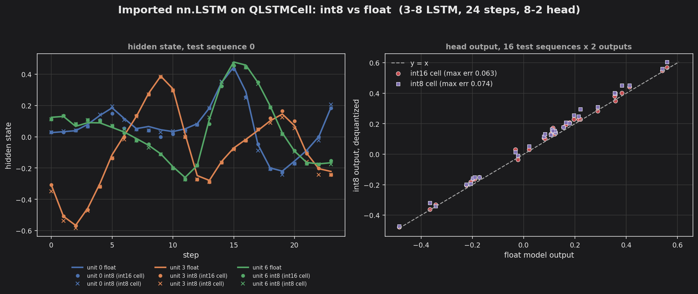

# import_lstm_demo — LSTM importer round-trip

End-to-end proof that the `apps/import_pytorch` importer turns a model that
starts with an `nn.LSTM` into something the C++ `cpp/qlstm.hpp::QLSTMCell`
runtime reproduces.

## What it does

1. `demo.py` lays out a deterministic float LSTM (3 inputs, 8 hidden units)
   exactly as `nn.LSTM`'s state dict (`weight_ih_l0`, `weight_hh_l0`,
   `bias_ih_l0`, `bias_hh_l0`, gates i, f, g, o) and adds a linear 8 → 2 head,
   with numpy only, no torch. It goes through `LSTM.from_state_dict`, the path
   a trained model takes.
2. It calibrates the model twice through `import_pytorch_model` on 128 noisy
   multi-sine sequences of 24 steps, once with an int16 cell state and once
   with an int8 one, and emits `weights_cell16.hpp` and `weights_cell8.hpp`:
   - the input, hidden-state and head-output scales and zero points, the
     hidden state's symmetric with zero point 0;
   - the cell scale and range, the fixed 8/127 gate (LUT input) scale, and a
     `lstm_CellType` typedef;
   - int8 input and recurrent weights, gate-major, each gate with its own
     scale, and the int32 gate biases in the LUT grid;
   - the head's int8 weights and int32 biases.

   It also emits `lstm_reference.hpp`: 16 held-out sequences, the float
   model's outputs for them, and the float hidden state after every step of
   the first one. These come from the LSTM equations written out separately
   in `demo.py`, not from the importer's own float forward, so the check
   cannot pass by the importer agreeing with itself.
3. `import_lstm_demo.cpp` fills `QLSTMScales` from each header, calls
   `buildQLSTMParams`, builds the sigmoid and tanh LUTs on the emitted LUT
   input scale, runs `QLSTMCell` over each sequence from zero state and the
   `QDense` head on the last hidden state, and compares the dequantized
   output with the float reference. It writes `output/import_lstm_demo.csv`
   (every output, both cell widths) and `output/import_lstm_demo_trace.csv`
   (the hidden state of sequence 0, step by step).

## Build & run

```bash
make            # build (debug)
make run        # run the parity check
make plot       # output/import_lstm_demo.png (needs matplotlib)
```

Expected:

```
import_lstm_demo parity test (16 sequences x 24 steps, 3-8 LSTM + 8-2 head)
  int16 cell: max |y_int8 - y_float| = 0.062568  (hidden trace 0.063370)  tolerance 0.080000 : PASS
  int8  cell: max |y_int8 - y_float| = 0.073909  (hidden trace 0.072047)  tolerance 0.080000 : PASS
```

The mean output error is 0.022 with the int16 cell and 0.035 with the int8
cell. The error is already 0.018 after the first step and does not grow over
the 24 steps: it is the floor set by the fixed 8/127 gate grid and the 1/128
tanh LUT, the same floor the single-step `QLSTMCell` unit test allows, not
drift.

The checked-in headers let the binary build without numpy. To regenerate
them:

```bash
make regenerate-pytorch   # runs demo.py (needs numpy)
```


