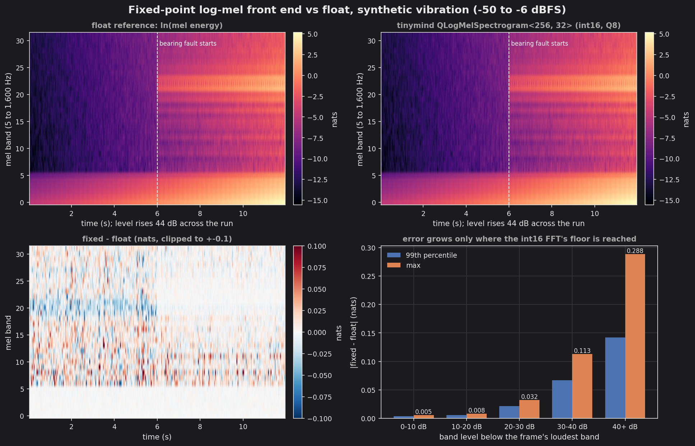

# logmel_vibration (fixed-point log-mel and MFCC front end)

`cpp/qmel.hpp` turns frames of int16 samples into log-mel energies and MFCCs
with integer arithmetic only. This example runs it over a synthetic
machine-vibration recording and compares every frame with the float
definition it implements.

## The recording

12 seconds at 3,200 samples per second, int16 (synthetic):

  * a motor at 29.5 Hz with four harmonics, plus broadband noise;
  * from 6 seconds on, a bearing fault: impacts at 107 Hz that ring a damped
    900 Hz structural resonance;
  * an overall level that rises from -50 dBFS to -6 dBFS across the run, so
    the front end sees frames 44 dB apart in level.

## The front end

`QLogMelSpectrogram<256, 32>` takes 256-sample frames (hop 128), applies a
Hann window, and computes 32 mel bands from 5 to 1,600 Hz on the HTK mel
scale. `QMfcc<32, 13>` then gives 13 MFCCs. Per frame:

1. Pre-emphasis (off here) and the Q1.15 window are computed exactly in
   64-bit arithmetic.
2. The windowed frame is shifted so that its largest sample lies in
   [2^14, 2^15). A quiet frame therefore reaches the int16 FFT at full
   scale.
3. `QRFFT1D<256>` runs on the shifted frame.
4. The triangular mel filters (Q0.16 weights, stored sparsely) are summed
   in 64 bits.
5. A fixed-point natural log is taken. The frame's shift and every fixed
   scaling are removed as an exact integer offset of the base-2 log.

The float definition is `ln(sum_k W[m][k] |DFT(x / 32768 * hann)[k]|^2)`.
This is torchaudio's `MelSpectrogram` (power 2, HTK mel scale, no filter
normalization) followed by a natural log. The tables come from the host
builders `buildQHannWindow`, `buildQFFTTwiddles`, `buildQMelFilterbank` and
`buildQDctMatrix`.

## Results

```
frames: 299 of 256 samples (hop 128), 246 filter weights, workspace 1028 bytes
|log-mel error| in nats, by band level below the frame's loudest band:
   0-10 dB:   944 bands  mean 0.0012  p99 0.0036  max 0.0055
  10-20 dB:  1159 bands  mean 0.0017  p99 0.0057  max 0.0083
  20-30 dB:  1550 bands  mean 0.0052  p99 0.0215  max 0.0320
  30-40 dB:  5133 bands  mean 0.0160  p99 0.0669  max 0.1131
    40+ dB:   782 bands  mean 0.0326  p99 0.1423  max 0.2885
worst MFCC error against the float DCT of the float log-mel: 0.1322
```

Bands within 20 dB of a frame's loudest band match the float definition to
within 0.01 nats, which is 0.04 dB. The error grows only for bands far below
the loudest one. There, the energy is close to the rounding floor of a 16-bit
FFT that has scaled the frame to full scale.

The error does not depend on the input level: frames at -50 dBFS are as
accurate as frames at -6 dBFS. The block scale is what makes this possible.



Top row: the float and fixed-point spectrograms. The fault's 900 Hz
resonance appears in bands 20 to 23 from 6 seconds on. Bottom left: the
signed difference. Bottom right: the error by level below each frame's
loudest band.

## Cost on a Cortex-M0+

Built with `arm-none-eabi-g++ -mcpu=cortex-m0plus -Os`, for N = 256 and 32
bands:

| | Size |
|---|---|
| Code for `QLogMelSpectrogram::forward` and `QMfcc::forward`, including `QRFFT1D` | 1,710 bytes |
| Deepest stack, from `-fstack-usage` | about 264 bytes |
| Caller-owned workspace | 1,028 bytes |
| Tables: window 512 B, twiddles 512 B, band start and length 128 B, filter weights 492 B | 1,644 bytes |
| DCT table for 13 MFCCs | 832 bytes |

The tables are host-built constants, so they live in flash.

On the boards
([`benchmarks/tier1_onboard`](../../benchmarks/tier1_onboard), `-O3`, with
pre-emphasis 0.97), a log-mel frame takes 185,172 cycles on the Cortex-M0+
of a NUCLEO-L031K6 (5.8 ms at 32 MHz) and 46,878 on the Cortex-M4 of a
NUCLEO-F411RE (0.47 ms at 100 MHz); the 13 MFCCs add 33,567 and 4,112.

## Build and run

```bash
cd examples/logmel_vibration
make release
make run       # writes output/logmel_vibration.csv, _mfcc.csv and _error.csv
make plot      # needs matplotlib in a venv
```
