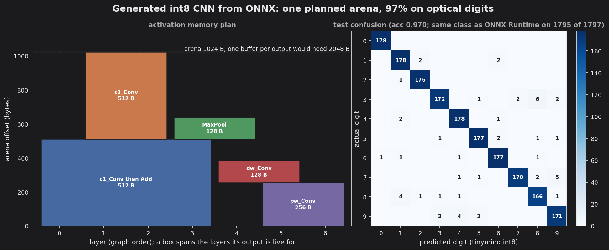

# onnx_digits_int8 (ONNX model -> generated tinymind model with a planned arena)

A small residual int8 CNN classifies the UCI optical digits (8x8 bitmaps,
1,797 test digits). Everything the C++ program runs is generated from an
ONNX model that ONNX Runtime quantized:

  * `weights.hpp` holds the int8 weights, int32 biases and requantizers
    (`apps/import_onnx/tinymind_import_onnx.py`);
  * `model.hpp` holds one `constexpr` tinymind layer object per layer, a
    static memory plan for every intermediate activation, and
    `forward(input, output, arena)` (`apps/import_onnx/tinymind_model_codegen.py`);
  * `reference.hpp` holds the input quantization table and, for each test
    digit, the class the float PyTorch model and ONNX Runtime's int8 model
    predict.

`onnx_digits_int8.cpp` reads the test set, maps each pixel onto the
model's int8 input grid, calls `forward()`, and compares the result with
the labels and with ONNX Runtime. It is built with `TINYMIND_ENABLE_FLOAT=0`
and `TINYMIND_ENABLE_STD=0`, so the generated model uses neither.

## The model

```
input 8x8x1
  -> Conv 3x3 (8 filters) + ReLU                 c1_Conv
  -> Conv 3x3 (8) + ReLU, added to its input     c2_Conv, Add
  -> MaxPool 2x2                                 MaxPool
  -> depthwise Conv 3x3 + ReLU                   dw_Conv
  -> pointwise Conv 1x1 (16) + ReLU              pw_Conv
  -> flatten -> dense (10 logits)                fc_Gemm
```

Training uses PyTorch (Adam, cosine schedule, 60 epochs, seed 1) on the
3,823 training digits. ONNX Runtime's `quantize_static` then quantizes the
model in QDQ format with per-channel weights, calibrated on 512 training
digits.

## Results

```
test digits:                    1797
tinymind int8 accuracy:         0.9699
ONNX Runtime int8 accuracy:     0.9699
float (PyTorch) accuracy:       0.9699
same class as ONNX Runtime:     1795 of 1797
activation arena:               1024 bytes (unshared 2048, busiest layer 1024)
```

The generated int8 model is as accurate as the float model. It predicts the
same class as ONNX Runtime for all but two digits. On both, ONNX Runtime's
two highest int8 logits are one step apart (69 and 70, 61 and 62), so a
requantization that the two runtimes round differently decides the class.
tinymind is right on one of the two digits and ONNX Runtime on the other.

The memory plan puts all seven layers' activations in 1,024 bytes. Giving
each output its own buffer would take 2,048 bytes. 1,024 bytes is also the
minimum: the first convolution's output and the second convolution's output
are both live while the residual `Add` runs, and each is 512 bytes. The `Add`
writes its result over the first convolution's output, which it is the last
layer to read.



On the left, each box is one arena buffer. It spans the layers its output is
live for and sits at the bytes it occupies. On the right is the confusion
matrix of the generated int8 model.

Compiled for a Cortex-M0+ (`arm-none-eabi-g++ -mcpu=cortex-m0plus -Os`), a
translation unit holding only `model.hpp` and a `main` that calls `forward`
is 7,326 bytes of code and read-only data (kernels, weights, requantizers
and layer objects). It has no `.data`, and its 1,098 bytes of `.bss` are the
arena plus the input and output buffers. Nothing is allocated on the heap.

## Build and run

```bash
cd examples/onnx_digits_int8
make release
make run      # accuracy, agreement with ONNX Runtime, CSVs in output/
make bench    # output/onnx_digits_int8_bench.csv: microseconds per inference on the host
make golden   # output/onnx_digits_int8.golden: int8 logits of the first 16 test digits
make plot     # output/onnx_digits_int8.png (needs matplotlib in a venv)
```

`make run` writes `output/onnx_digits_int8.csv` (one row per test digit:
label, tinymind, ONNX Runtime and float predictions, and the 64 pixels),
`output/onnx_digits_int8_plan.csv` (the arena buffers) and
`output/onnx_digits_int8_summary.csv` (arena, unshared and busiest-layer
bytes).

## Regenerating the model

The generated headers are committed, so building the example needs no
Python. To retrain and regenerate them, use a virtual environment with
`torch`, `onnx`, `onnxruntime` and `numpy` (never the system Python):

```bash
python3 -m venv .venv && .venv/bin/pip install numpy torch onnx onnxruntime
make regenerate PY=.venv/bin/python
```
