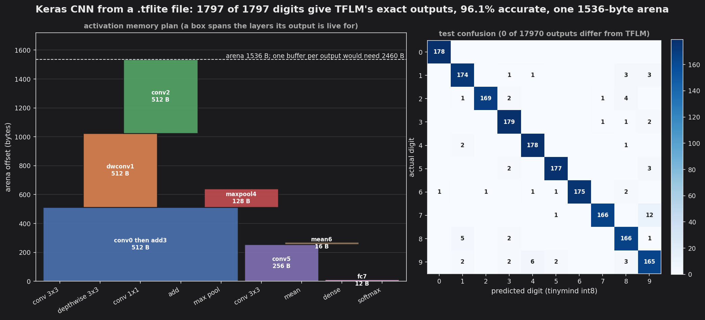

# tflite_digits_int8

A residual int8 CNN classifies the UCI optical digits, and none of the model
code is written by hand. Keras trains it, TensorFlow's `TFLiteConverter`
quantizes it to an int8 `.tflite` model, and `apps/import_tflite` generates two
headers from that file:

  * `weights.hpp` holds the int8 weights, int32 biases and requantizers;
  * `model.hpp` holds one `constexpr` layer object per layer, a static memory
    plan that gives every activation a fixed offset in one arena, and
    `forward(input, output, arena)`.

`tflite_digits_int8.cpp` reads the test set, maps each pixel through the input
table, calls `forward()`, and compares all ten outputs of every digit with
the outputs TensorFlow Lite for Microcontrollers (TFLM) computed for the same
digit. The program fails unless every one of them is equal.

## The model

On 8x8x1 input: `Conv 3x3 (8), ReLU` -> a residual block (`depthwise 3x3,
ReLU6` -> `Conv 1x1 (8)`, added back to its input) -> `MaxPool 2x2` ->
`Conv 3x3 (16), ReLU` -> `GlobalAveragePooling2D` -> `Dense (10)` -> softmax.
`train.py` trains it in Keras (Adam, 60 epochs, seed 1, deterministic ops) and
converts it with full-integer int8 quantization (int8 input and output, 512
calibration digits).

The converter writes nine operators: `CONV_2D` (with fused RELU),
`DEPTHWISE_CONV_2D` (fused RELU6), `CONV_2D`, `ADD`, `MAX_POOL_2D`, `CONV_2D`,
`MEAN` (what `GlobalAveragePooling2D` becomes), `FULLY_CONNECTED` and
`SOFTMAX`. The importer maps them onto `QConv2DPerChannel`,
`QDepthwiseConv2D`, `QAdd`, `QMaxPool2D`, TFLM's integer mean, `QDense` and
`QSoftmaxFixedPoint1D`.

## Results

```
test digits:                    1797
tinymind int8 accuracy:         0.9610
TFLM int8 accuracy:             0.9610
float (Keras) accuracy:         0.9610
same 10 outputs as TFLM:        1797 of 1797 digits (0 of 17970 outputs differ)
same class as Keras:            1788 of 1797
activation arena:               1536 bytes (unshared 2460, busiest layer 1536)
weights:                        1520 bytes
```

All 17,970 outputs equal TFLM's. Every activation lives in a 1,536-byte
arena, against 2,460 bytes with one buffer per layer output; 1,536 bytes is
also the minimum, since that many bytes are live during the busiest layer. The
residual `ADD` writes its result over the first convolution's output, which
it is the last layer to read.



On the left, each box is an arena buffer, spanning the layers its output is
live for and sitting at the bytes it occupies. On the right is the confusion
matrix of the generated model on the 1,797 test digits.

## Build and run

```bash
make release
make run      # accuracy, agreement with TFLM, CSVs in output/
make bench    # output/tflite_digits_int8_bench.csv: microseconds per inference on the host
make golden   # output/tflite_digits_int8.golden: int8 outputs of the first 16 test digits
make plot     # output/tflite_digits_int8.png (needs matplotlib in a venv)
```

`make run` writes `output/tflite_digits_int8.csv` (one row per test digit:
label, the tinymind, TFLM and Keras predictions, whether all ten outputs
matched TFLM's, the winning softmax output, and the 64 pixels),
`output/tflite_digits_int8_plan.csv` (the arena buffers) and
`output/tflite_digits_int8_summary.csv`.

The model is built with `TINYMIND_ENABLE_FLOAT=0` and
`TINYMIND_ENABLE_STD=0`; only the driver's file I/O and timer are hosted.

## Regenerating the model

The `.tflite` model (`models/digits_int8.tflite`), the generated headers and
`reference.hpp` (the input table, the Keras predictions and TFLM's outputs for
every test digit) are committed, so building the example needs no Python. To
retrain and regenerate them, use a virtual environment with `numpy`,
`tensorflow` and `tflite-micro` (never the system Python):

```bash
python3 -m venv .venv && .venv/bin/pip install numpy tensorflow tflite-micro
make regenerate PY=.venv/bin/python
```

With TensorFlow 2.21 a second run reproduces the model and every header byte
for byte.
