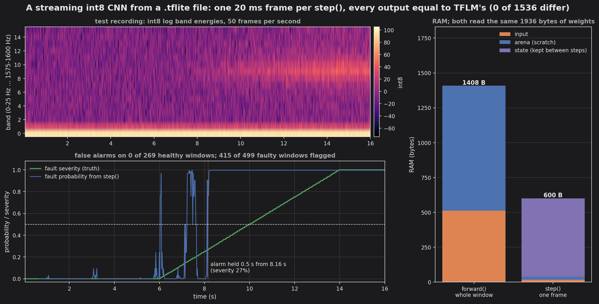

# tflite_streaming_int8

A small int8 CNN watches a machine's vibration for a bearing fault, one 20 ms
frame at a time. It reads a window of 32 frames (0.64 s), and a device that
reruns it every 20 ms recomputes 31 frames it has already computed. The
streaming form computes only the new one.

Keras trains the model, TensorFlow's `TFLiteConverter` quantizes it to an
int8 `.tflite` model, and `apps/import_tflite` generates three headers from
that one file:

  * `weights.hpp` holds the int8 weights, int32 biases and requantizers;
  * `model.hpp` holds `forward(input, output, arena)` over the whole 32-frame
    window;
  * `model_stream.hpp` (namespace `vibration::stream`) holds
    `step(frame, output, state, arena)`, which takes one new frame and keeps,
    in a caller-owned state, the last frames each layer still needs.

`tflite_streaming_int8.cpp` feeds a 16-second test recording to `step()`
frame by frame. At every frame from the 32nd on, it also runs `forward()` over
the window ending there, and it compares both outputs with the ones
TensorFlow Lite for Microcontrollers (TFLM) computed for that window. The
program fails unless every one of them is equal.

## The signal and the model

The vibration is synthetic, sampled at 3,200 samples per second. A motor runs
at a speed that wanders between 28 and 32 Hz, with four harmonics and
broadband noise. A damaged bearing adds about 100 impacts per second, each
ringing a structural resonance near 900 Hz that decays within a few
milliseconds. Every 64 samples (20 ms), a 128-sample Hann window gives 16
log band energies of 100 Hz each: one frame.

The model reads 32 frames, as a `[32][1][16]` tensor with time along the
height:

`Conv 3x1 (16), ReLU` -> `depthwise 5x1, ReLU` -> `Conv 1x1 (16), ReLU` ->
`depthwise 9x1, ReLU` -> `Conv 1x1 (16), ReLU` -> `depthwise 18x1` ->
`Conv 1x1 (8), ReLU` -> `Dense (2)` -> softmax.

Every convolution along time has stride 1 and no padding, so the newest frame
of each layer's output depends only on the newest frames of its input. The
receptive field (3 + 4 + 8 + 17 frames) is exactly the 32-frame window.

`train.py` trains it (Adam, 30 epochs, seed 1) on 600 three-second recordings,
half of them with a fault of constant severity between 15% and 100%. It then
converts the model with full-integer int8 quantization and 512 calibration
windows. In the 16-second test recording the machine is healthy for 6
seconds, and then the fault grows steadily to full severity at 14 seconds.

## How step() works

The importer's code generator rewrites each layer that slides a window of K
frames along time (here the convolutions; also pools, a mean or a dense
layer over time) to read just K frames and write one. Every tensor that such a
layer reads gets a history in the state: its last K frames, in order, so the
layer reads them as one contiguous `[K][W][C]` tensor and runs the same
kernel, with the same requantizer, as `forward()`.

Each `step()` moves every history back one frame and writes the newest frame
at its end. The per-step scratch arena holds only one frame per layer. Because
every output frame goes through the same arithmetic, the streamed output for
the window that ends at a frame equals `forward()`'s for that window, bit for
bit, from the 32nd frame after `reset()` on.

| | `forward()` | `step()` |
|---|---|---|
| input | 512 B (32 frames) | 16 B (one frame) |
| scratch arena | 896 B | 24 B |
| state kept between calls | none | 560 B |
| weights | 1,936 B | the same 1,936 B |

## Results

```
frames:                         799 (768 windows of 32 frames)
step() outputs differing from TFLM:    0 of 1536
forward() outputs differing from TFLM: 0 of 1536
false alarms:                   0 of 269 healthy windows
fault detected:                 415 of 499 faulty windows
first alarm:                    6.04 s (severity 1%)
first alarm held for 0.5 s:     8.16 s (severity 27%)
memory, forward():              512 B input window + 896 B arena
memory, step():                 16 B frame + 24 B arena + 560 B state
weights:                        1936 bytes, shared by both
```

`step()` and `forward()` both reproduce all 1,536 of TFLM's outputs. The
detector raises no alarm on any of the 269 healthy windows. The first
alarm, at 6.04 s, lasts three frames, when the fault has barely started, and
the alarm holds from 8.16 s on, at 27% severity. All 84 faulty windows it
misses come before 8.16 s, while the impacts are still weak.

On the build host (x86-64, `-O3`), `make bench` measured about 0.9 µs per
`step()` against about 10.7 µs per `forward()` over the window: roughly 12
times less work for every 20 ms frame. On a Cortex-M4 (NUCLEO-F411RE), the
same streaming code generation runs the MLPerf Tiny streaming wake word model
13 times faster than TFLM reruns its whole window; see
`benchmarks/framework_comparison_f411`.



The top panel is the test recording as the model sees it: 16 int8 band
energies per frame, with the bands around the fault's resonance (800 to
1,100 Hz) brightening from about 7 s on. The bottom panel is the fault probability `step()` gives at every
frame, against the fault's true severity. On the right is the RAM each form
needs.

## Build and run

```bash
make release
make run      # agreement with TFLM, detection, CSVs in output/
make bench    # output/tflite_streaming_int8_bench.csv: microseconds per step() and per forward() on the host
make golden   # output/tflite_streaming_int8.golden: step()'s int8 outputs for the first 16 full windows
make plot     # output/tflite_streaming_int8.png (needs matplotlib in a venv)
```

`make run` writes `output/tflite_streaming_int8.csv` (one row per frame: time,
fault severity, the fault output of `step()` on the 1/256 grid, whether a
full window has arrived, and the 16 int8 band energies) and
`output/tflite_streaming_int8_summary.csv`.

The models are built with `TINYMIND_ENABLE_FLOAT=0` and
`TINYMIND_ENABLE_STD=0`; only the driver's file I/O and timer are hosted.

## Regenerating the model

The `.tflite` model (`models/streaming_int8.tflite`), the generated headers
and `reference.hpp` (the test recording's int8 frames, the fault severity at
each frame and TFLM's outputs for every window) are committed, so building
the example needs no Python. To retrain and regenerate them, use a virtual
environment with `numpy`, `tensorflow` and `tflite-micro` (never the system
Python):

```bash
python3 -m venv .venv && .venv/bin/pip install numpy tensorflow tflite-micro
make regenerate PY=.venv/bin/python
```

With TensorFlow 2.21 a second run reproduces the model and every header byte
for byte.
