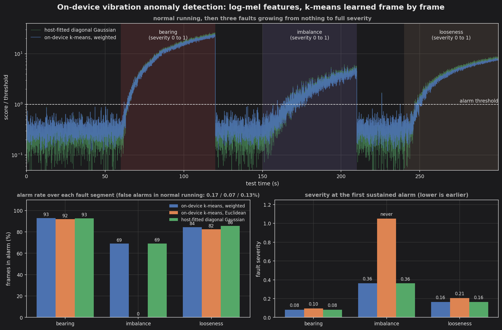

# vibration_anomaly (anomaly detection that learns "normal" on the device)

A vibration sensor node has to learn what normal looks like on the machine it is
bolted to, and then raise an alarm when that changes. This example runs that
pipeline on a synthetic machine, frame by frame, the way a node would.
Everything on the detection path uses integer arithmetic only:

  * `cpp/qmel.hpp` computes the log-mel features;
  * `cpp/qanomaly.hpp` learns the baseline and scores each frame.

## The machine

The signal is int16 at 3,200 samples per second. The motor's speed wanders
between 28 and 32 Hz, and its load moves the overall level by up to ±6 dB.
The spectrum has the running speed, three harmonics and broadband noise. Three
faults each grow from nothing to full severity over 60 seconds:

  * **bearing**: an outer-race defect. Impacts at 3.57x the running speed
    ring a damped 900 Hz resonance.
  * **imbalance**: the 1x component grows to three times its normal size.
  * **looseness**: half-order and 5x to 12x harmonics appear.

## The pipeline

1. **Features.** `QLogMelSpectrogram<256, 32>` takes each 256-sample frame
   (hop 128) and produces 32 mel bands from 5 to 1,600 Hz. The frame's mean
   band is subtracted, so the features describe the spectrum's shape rather
   than its level. They are then mapped to int8 at 1/8 nat per step.
2. **Learn (120 s).** `QKMeansAnomalyTrainer<32, 8>` learns 8 centroids
   with online k-means, one frame at a time. It also measures how much each
   feature varies around its centroid.
3. **Calibrate (60 s).** The trainer freezes the centroids and sets one
   weight per feature, inversely proportional to that feature's variance in
   normal running. It then measures each cluster's mean squared radius.
4. **Threshold (60 s).** The alarm threshold is the largest score seen,
   times 1.25.
5. **Test.** 60 s of normal running, then each fault, with 30 s of normal
   running between faults.

For comparison, two other detectors are scored on the same features:

  * the same trainer with the feature weights off, which gives a plain
    Euclidean distance;
  * a one-component diagonal Gaussian (`QDiagGaussianAnomaly`), fitted on
    the host to the 120 s of learning frames.

Both use the same thresholding rule.

## Results

```
learned 8 clusters from 2998 frames; thresholds: k-means 793 and 832 (Q8 radii^2), Gaussian 14051 (Q8 nats)
kmeans     normal running: 3000 frames, false alarms 0.17%
kmeans     bearing  : AUC 0.985, alarms on 92.9% of frames, first sustained alarm at severity 0.08
kmeans     imbalance: AUC 0.943, alarms on 69.0% of frames, first sustained alarm at severity 0.36
kmeans     looseness: AUC 0.961, alarms on 84.5% of frames, first sustained alarm at severity 0.16
euclidean  normal running: 3000 frames, false alarms 0.07%
euclidean  bearing  : AUC 0.985, alarms on 91.9% of frames, first sustained alarm at severity 0.10
euclidean  imbalance: AUC 0.761, alarms on 0.0% of frames, first sustained alarm at severity -1.00
euclidean  looseness: AUC 0.958, alarms on 82.3% of frames, first sustained alarm at severity 0.21
gaussian   normal running: 3000 frames, false alarms 0.13%
gaussian   bearing  : AUC 0.984, alarms on 92.7% of frames, first sustained alarm at severity 0.08
gaussian   imbalance: AUC 0.946, alarms on 69.1% of frames, first sustained alarm at severity 0.36
gaussian   looseness: AUC 0.964, alarms on 85.5% of frames, first sustained alarm at severity 0.16
```

A "sustained alarm" is 8 alarmed frames in a row, about a third of a second.
Severity -1.00 means no sustained alarm ever happened.

The k-means trained on the device does as well as the Gaussian fitted on the
host:

  * It catches the bearing defect at 8% of full severity and looseness at 16%.
  * The two detectors raise alarms on the same share of each fault, within
    1.1 percentage points.
  * False alarms in normal running stay at or below 0.17%.

The feature weights are what make this work. The imbalance changes a few
low-frequency bands, and in a plain Euclidean distance over 32 features
that change is lost among bands that vary a lot in normal running. The
Euclidean k-means never raises a sustained alarm on it. With the weights,
a band that is normally steady counts for more when it moves.

Over machine seeds 11 to 15, the averages hold:

| | Bearing | Imbalance | Looseness |
|---|---|---|---|
| Weighted k-means, alarm rate | 92.0% | 65.2% | 84.9% |
| Weighted k-means, first alarm at severity | 0.10 | 0.40 | 0.17 |
| Gaussian, alarm rate | 92.3% | 65.2% | 85.1% |

  * False alarms were 0.10–0.17% on every seed.
  * The Euclidean k-means never raised a sustained alarm on the imbalance
    fault on any seed (AUC 0.76–0.78).



Top: score divided by threshold over the test run, on a log scale; the
faults are shaded. Bottom left: the share of each fault's frames in alarm.
Bottom right: the severity at which each fault first raised a sustained
alarm.

## Cost on a Cortex-M0+

Built with `arm-none-eabi-g++ -mcpu=cortex-m0plus -Os`, for 32 features and
8 clusters:

  * **Code:** 1,274 bytes for learning, calibration and scoring, plus the
    Gaussian score.
  * **Stack:** at most 72 bytes.
  * **Trainer RAM:** 1,256 bytes, which holds the model it learns.

Together with the log-mel front end (1,710 bytes of code and a 1,028-byte
workspace) and a 512-byte frame buffer, the whole node fits in about 3 KB of
RAM. The STM32L031K6 has 8 KB.

On the NUCLEO-L031K6 at 32 MHz
([`benchmarks/tier1_onboard`](../../benchmarks/tier1_onboard), `-O3`), a
k-means score takes 23,571 cycles (0.74 ms), a learning step 30,700
(0.96 ms) and a 4-component Gaussian score 12,436 (0.39 ms). With the
185,172-cycle log-mel frame, scoring one frame takes 6.5 ms of the 80 ms
the frame lasts at 3.2 kHz: 8% of the CPU.

## Build and run

```bash
cd examples/vibration_anomaly
make release
make run       # writes output/vibration_anomaly.csv and output/vibration_anomaly_summary.csv
make plot      # needs matplotlib in a venv
```

The signal is synthetic. A real machine needs a longer learning period that
covers all of its normal operating states.
